**English** | [中文](./README.md)

# Mellow for Fcitx5

[](https://github.com/sanweiya/fcitx5-mellow-themes/stargazers) [](https://github.com/sanweiya/fcitx5-mellow-themes/stargazers) [](https://github.com/sanweiya/fcitx5-mellow-themes/stargazers) [](https://github.com/sanweiya/fcitx5-mellow-themes/stargazers) [](https://github.com/sanweiya/fcitx5-mellow-themes/stargazers)

Aesthetic, modern fcitx5 themes featuring rounded rectangle design.

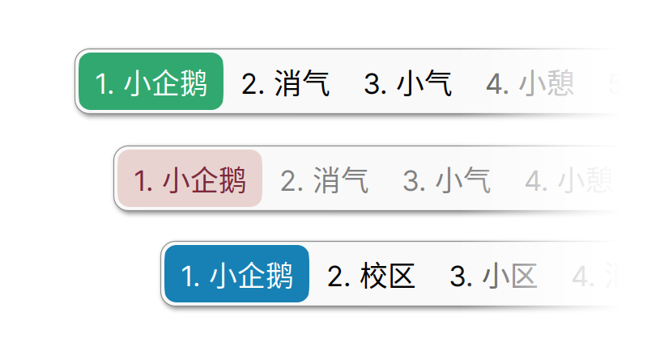

> Straight angle enthusiasts? Why not check out [fcitx5-inflex-themes](https://github.com/sanweiya/fcitx5-inflex-themes)

## ⚠️~~What's New~~

- ~~A semi-transparent, blurred input window for KWin~~

  
  
  This variant of themes will no longer be released as I can't be bothered to fix it.

## Notice

Intended for: 

- X11, LoDPI

- Wayland, LoDPI

- Wayland, HiDPI

For users of “X11, HiDPI”, ~~please check [fcitx5-mellow-themes-legacy](https://github.com/sanweiya/fcitx5-mellow-themes-legacy) (Obsolete)~~, the display scaling for the themes may not be ideal.

## Usage

### Manual Installation (for the current user)

```
git clone https://github.com/sanweiya/fcitx5-mellow-themes.git
```

```
cd fcitx5-mellow-themes/
```

The repository ships four variant directories; pick **one** to install (theme folders share the same names inside, so installing multiple variants at once overwrites each other):

| Directory | Variant | Intended for |
| --- | --- | --- |
| `mellow/` | Standard | X11 / Wayland, LoDPI |
| `mellow-2x/` | Standard 2x | Wayland, HiDPI |
| `mellow-compact/` | Compact | X11 / Wayland, LoDPI |
| `mellow-compact-2x/` | Compact 2x | Wayland, HiDPI |

```
mkdir -p ~/.local/share/fcitx5/themes && cp -r mellow/mellow-* ~/.local/share/fcitx5/themes
```

Replace `mellow/` in the command with any of the other three directories to install that variant. Of course you can choose the parts you need to copy.

### Community Software Repository

#### Arch Linux

[AUR package](https://aur.archlinux.org/packages/fcitx5-mellow-themes-git) maintained by yjun.

You can use your preferred AUR helper, for example:

```
yay -S fcitx5-mellow-themes-git
```

## Screenshots

- **Youlan 釉蓝**
  
  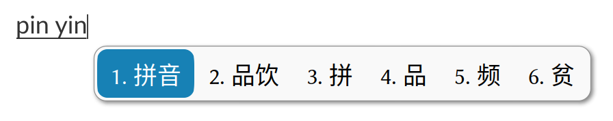 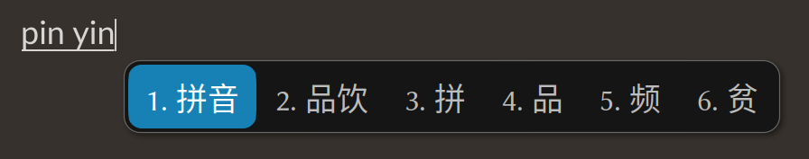
  
- **Sakura 灰樱**
  
  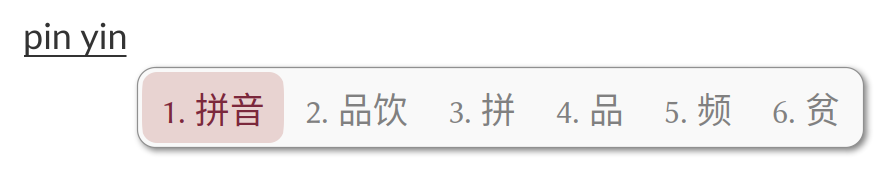 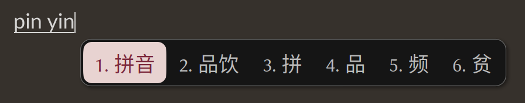
  
- **Vermilion 朱砂**
  
  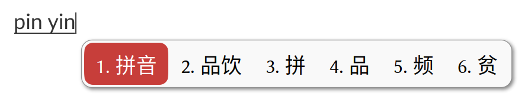 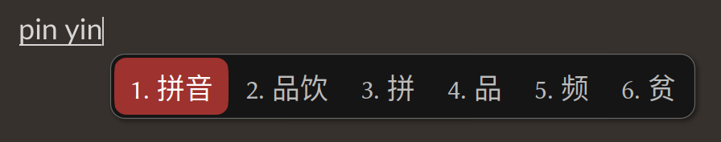
  
- **Wechat 微言**
  
   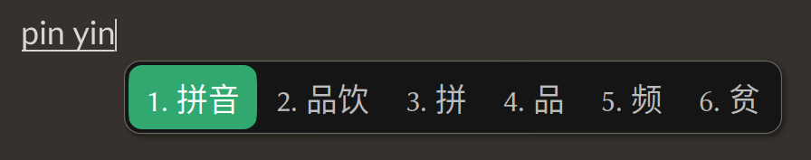
  
- **Graphite 石墨**
  
  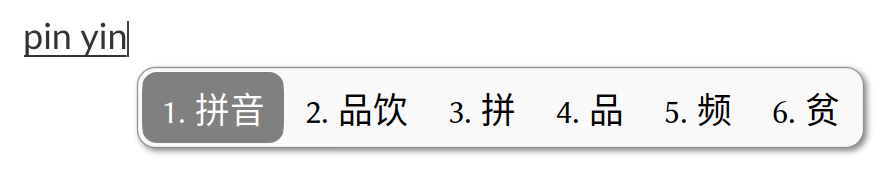 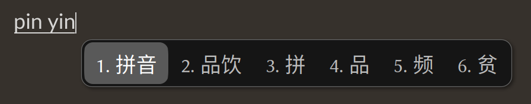
  
- **Vertical & Dual-line**
  
   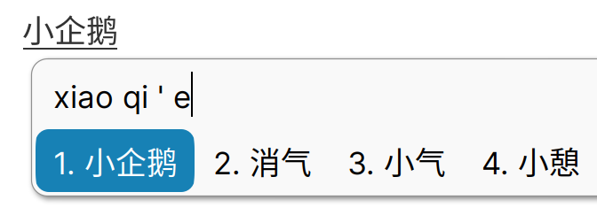

## EOF
