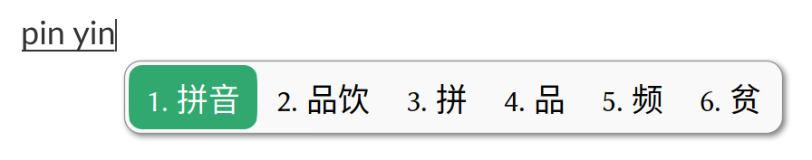
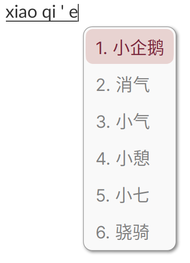

**English** | [中文](./README.md)

# Mellow for Fcitx5

[](https://github.com/sanweiya/fcitx5-mellow-themes/stargazers) [](https://github.com/sanweiya/fcitx5-mellow-themes/stargazers) [](https://github.com/sanweiya/fcitx5-mellow-themes/stargazers) [](https://github.com/sanweiya/fcitx5-mellow-themes/stargazers) [](https://github.com/sanweiya/fcitx5-mellow-themes/stargazers)

Aesthetic, modern fcitx5 themes featuring rounded rectangle design.


**November 2026 update**: this release only adds more variants and the custom theme generator script — there is no need to update.

## Usage

### Manual Installation (for the current user)

```
git clone https://github.com/sanweiya/fcitx5-mellow-themes.git
```

```
cd fcitx5-mellow-themes/
```

The repository ships four variant directories. Compact themes carry a Compact marker in both folder and display name (`mellow-compact-*` / `Mellow Compact *`) and can coexist with the standard ones; 2x themes share names with their 1x counterparts, so installing 2x overwrites them:

| Directory | Variant | Intended for |
| --- | --- | --- |
| `mellow/` | Standard | Default |
| `mellow-2x/` | Standard 2x | X11 HiDPI |
| `mellow-compact/` | Compact | Default |
| `mellow-compact-2x/` | Compact 2x | X11 HiDPI |

```
mkdir -p ~/.local/share/fcitx5/themes && cp -r mellow/mellow-* ~/.local/share/fcitx5/themes
```

Replace `mellow/` in the command with any of the other three directories to install that variant. Of course you can choose the parts you need to copy.

### Custom Theme Generator

The repository root ships an interactive generator script, `generate-theme.sh`: give it any accent color and it produces a matching Mellow theme — density (standard/compact), panel tone (light/dark) and scale variant (1x/2x) are all selectable, while the highlight / normal text colors can be chosen automatically by contrast. Generated themes are written to the `generated/` directory.

Dependencies: only the 2x scale option needs Python 3 (scaling is performed by the repository's own `tools/` scripts); the generation templates come from the in-repo graphite themes (`mellow/mellow-graphite*` and `mellow-compact/mellow-compact-graphite*`). The interactive prompts are in Chinese:

```
== Mellow 主题生成器 ==

1/7 主题色（高亮背景）
    用于候选词高亮条与预编辑高亮段底色。
    格式：六位十六进制，如 #AFEEEE。
> 000000

2/7 密度（留空=0）
    0 · 宽松（mellow 素材）
    1 · 紧凑（mellow-compact 素材）
> 1

3/7 面板背景（留空=0）
    0 · 浅色（面板 #f9f9f9，配深色文字）
    1 · 深色（面板 #151515，配浅色文字）
> 0

4/7 缩放方式（按桌面环境选择，留空=0）
    0 · 不缩放 —— 使用 1x 素材
        适用：LowDPI、Wayland HiDPI

    1 · 2x 缩放 —— 使用 2x 素材（几何整体放大一倍）
        适用：X11 HiDPI（fcitx5 在该环境无原生缩放，以 2x 素材补偿）
> 1

5/7 高亮候选词文字颜色
    高亮条上候选词的文字颜色，六位十六进制。
    留空 = 自动 —— 按主题色深浅，在纯黑/纯白中取对比度更高者。
> 

6/7 一般文字颜色
    候选词与预编辑的正常文字颜色，六位十六进制。
    留空 = 自动 —— 浅色面板 #000000，深色面板 #bcbcbc（同已有主题）。
> 

7/7 主题名
    预填可编辑，回车确认；显示名 Name= 由目录名推导。
> mellow-compact-000000
```

### Community Software Repository (outdated)

#### AUR

~~https://aur.archlinux.org/packages/fcitx5-mellow-themes-git~~

## Screenshots

- **Youlan 釉蓝**
  
   
  
- **Sakura 灰樱**
  
   
  
- **Vermilion 朱砂**
  
   
  
- **Wechat 微言**
  
   
  
- **Graphite 石墨**
  
   
  
- **Vertical & Dual-line**
  
   

## EOF
