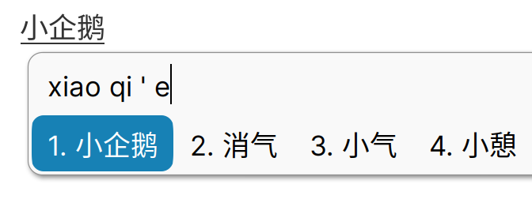

**中文** | [English](./README.en.md)

# Mellow for Fcitx5

[](https://github.com/sanweiya/fcitx5-mellow-themes/stargazers) [](https://github.com/sanweiya/fcitx5-mellow-themes/stargazers) [](https://github.com/sanweiya/fcitx5-mellow-themes/stargazers) [](https://github.com/sanweiya/fcitx5-mellow-themes/stargazers) [](https://github.com/sanweiya/fcitx5-mellow-themes/stargazers)

美观、现代的 fcitx5 主题，采用圆角矩形设计。


> 直角爱好者？不妨来看看 [fcitx5-inflex-themes](https://github.com/sanweiya/fcitx5-inflex-themes)

## 注意

适用于：

- X11, LoDPI

- Wayland, LoDPI

- Wayland, HiDPI

如果你在使用“X11, HiDPI”，~~请选择 [fcitx5-mellow-themes-legacy](https://github.com/sanweiya/fcitx5-mellow-themes-legacy)（已废弃）~~，本主题的显示比例可能不尽人意。

## 使用方法

### 手动安装 (为当前用户) 

```
git clone https://github.com/sanweiya/fcitx5-mellow-themes.git
```

```
cd fcitx5-mellow-themes/
```

仓库包含四个变体目录，按需选择安装：紧凑版主题目录与显示名均带 Compact 标识（`mellow-compact-*` / `Mellow Compact *`），可与普通版同时安装；2x 与对应 1x 的主题同名，安装 2x 会覆盖同名 1x 主题：

| 目录 | 变体 | 适用环境 |
| --- | --- | --- |
| `mellow/` | 普通版 | X11 / Wayland, LoDPI |
| `mellow-2x/` | 普通版 2x | Wayland, HiDPI |
| `mellow-compact/` | 紧凑版 | X11 / Wayland, LoDPI |
| `mellow-compact-2x/` | 紧凑版 2x | Wayland, HiDPI |

```
mkdir -p ~/.local/share/fcitx5/themes && cp -r mellow/mellow-* ~/.local/share/fcitx5/themes
```

把命令中的 `mellow/` 换成其余三个目录之一，即可安装对应变体。当然，也可以自己选择需要复制的部分。

### 社区软件源

#### Arch Linux

[AUR package](https://aur.archlinux.org/packages/fcitx5-mellow-themes-git) maintained by yjun.

You can use your preferred AUR helper, for example:

```
yay -S fcitx5-mellow-themes-git
```

## Screenshots

- **Youlan 釉蓝**
  
   
  
- **Sakura 灰樱**
  
   
  
- **Vermilion 朱砂**
  
   
  
- **Wechat 微言**
  
   
  
- **Graphite 石墨**
  
   
  
- **Vertical & Dual-line**
  
   

## EOF
