**中文** | [English](./README.en.md)

# Mellow for Fcitx5

[](https://github.com/sanweiya/fcitx5-mellow-themes/stargazers) [](https://github.com/sanweiya/fcitx5-mellow-themes/stargazers) [](https://github.com/sanweiya/fcitx5-mellow-themes/stargazers) [](https://github.com/sanweiya/fcitx5-mellow-themes/stargazers) [](https://github.com/sanweiya/fcitx5-mellow-themes/stargazers)

美观、现代的 fcitx5 主题，采用圆角矩形设计。

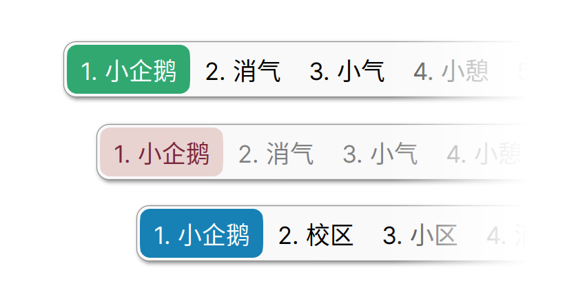

**2026年11月更新**：仅增加了更多变体和自定义生成脚本，可以不必更新。

## 使用方法

### 手动安装 (为当前用户) 

```
git clone https://github.com/sanweiya/fcitx5-mellow-themes.git
```

```
cd fcitx5-mellow-themes/
```

仓库包含四个变体目录，按需选择安装：紧凑版主题目录与显示名均带 Compact 标识（`mellow-compact-*` / `Mellow Compact *`），可与普通版同时安装；2x 与对应 1x 的主题同名，安装 2x 会覆盖同名 1x 主题：

| 目录 | 变体 | 适用环境 |
| --- | --- | --- |
| `mellow/` | 普通版 | 默认 |
| `mellow-2x/` | 普通版 2x | X11 HiDPI |
| `mellow-compact/` | 紧凑版 | 默认 |
| `mellow-compact-2x/` | 紧凑版 2x | X11 HiDPI |

```
mkdir -p ~/.local/share/fcitx5/themes && cp -r mellow/mellow-* ~/.local/share/fcitx5/themes
```

把命令中的 `mellow/` 换成其余三个目录之一，即可安装对应变体。当然，也可以自己选择需要复制的部分。

### 自定义主题生成器

仓库根目录提供交互式生成脚本 `generate-theme.sh`：指定任意主题色即可生成同风格的 Mellow 主题，密度（宽松/紧凑）、面板明暗、缩放档（1x/2x）可选，高亮候选词与一般文字颜色留空时按对比度自动选择。生成结果输出至 `generated/` 目录。

依赖：仅 2x 缩放档需要 Python 3（缩放由仓库内 `tools/` 脚本完成）；生成模板取自仓库内 graphite 主题（`mellow/mellow-graphite*` 与 `mellow-compact/mellow-compact-graphite*`）。

```
== Mellow 主题生成器 ==

1/7 主题色（高亮背景）
    用于候选词高亮条与预编辑高亮段底色。
    格式：六位十六进制，如 #AFEEEE。
> 000000

2/7 密度（留空=0）
    0 · 宽松（mellow 素材）
    1 · 紧凑（mellow-compact 素材）
> 1

3/7 面板背景（留空=0）
    0 · 浅色（面板 #f9f9f9，配深色文字）
    1 · 深色（面板 #151515，配浅色文字）
> 0

4/7 缩放方式（按桌面环境选择，留空=0）
    0 · 不缩放 —— 使用 1x 素材
        适用：LowDPI、Wayland HiDPI

    1 · 2x 缩放 —— 使用 2x 素材（几何整体放大一倍）
        适用：X11 HiDPI（fcitx5 在该环境无原生缩放，以 2x 素材补偿）
> 1

5/7 高亮候选词文字颜色
    高亮条上候选词的文字颜色，六位十六进制。
    留空 = 自动 —— 按主题色深浅，在纯黑/纯白中取对比度更高者。
> 

6/7 一般文字颜色
    候选词与预编辑的正常文字颜色，六位十六进制。
    留空 = 自动 —— 浅色面板 #000000，深色面板 #bcbcbc（同已有主题）。
> 

7/7 主题名
    预填可编辑，回车确认；显示名 Name= 由目录名推导。
> mellow-compact-000000
```

### KWin 半透明模糊（已停止发布）

KWin 下的半透明模糊变体已停止发布，本仓库不再提供。如有需要，可基于现有主题素材借助 AI Agent 自行制作并测试，十分容易。

### 社区软件源 (已过时)

#### AUR

~~https://aur.archlinux.org/packages/fcitx5-mellow-themes-git~~

## Screenshots

- **Youlan 釉蓝**
  
  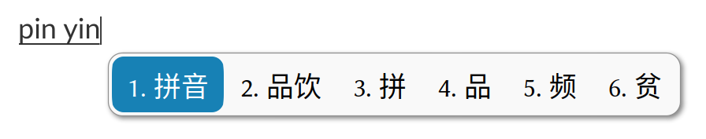 
  
- **Sakura 灰樱**
  
  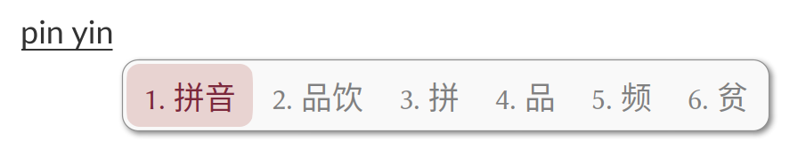 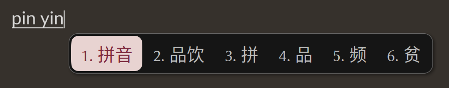
  
- **Vermilion 朱砂**
  
  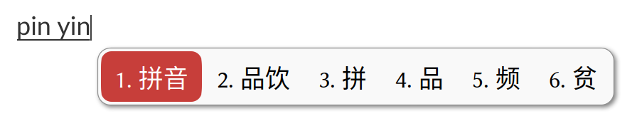 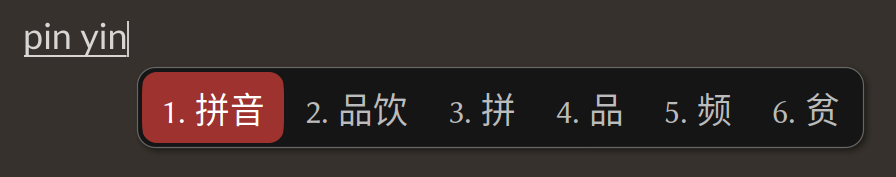
  
- **Wechat 微言**
  
  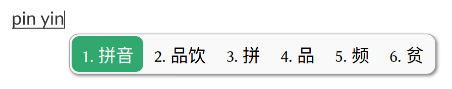 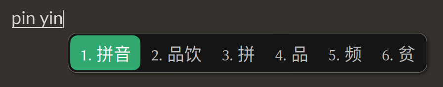
  
- **Graphite 石墨**
  
  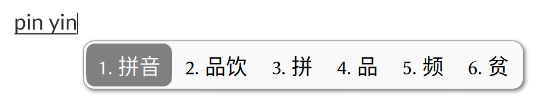 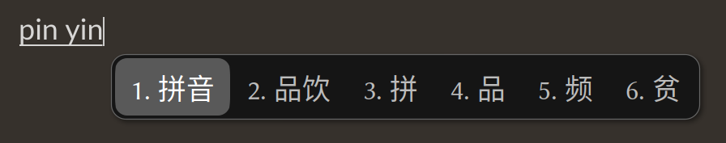
  
- **Vertical & Dual-line**
  
  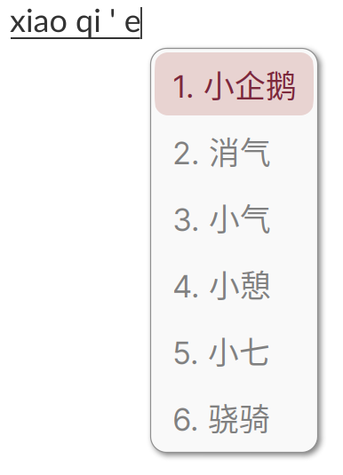 

## EOF
